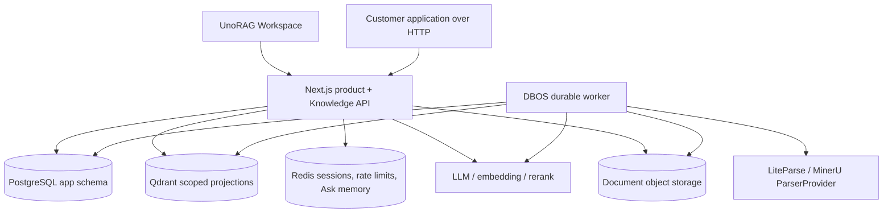
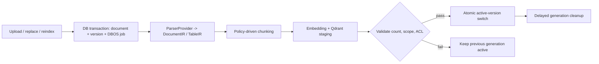

# UnoRAG 系统架构

本文描述当前产品运行时。迁移过程和被取代的设计保存在 [`adr/`](./adr/)，不作为操作指南。

## 系统边界

UnoRAG 是可私有化部署的知识产品，也提供可嵌入的 Knowledge API。浏览器通过 Session、
客户应用通过 Service Key 进入同一个 Next.js 产品边界。Worker 和数据存储永远不是公网入口。
当前默认交付模型是一位客户一套独立实例；Organization 表示该客户企业，Workspace 用于企业内部
部门、项目和权限隔离，而不是让互不相关的客户共享一个公网 SaaS 实例。



仓库中没有内部 FastAPI 产品服务、outbox Worker、Python 生命周期 Worker 或单独维护的客户端运行时。

## 职责所有权

| Component | Owns | Must not own |
|---|---|---|
| Next.js | auth, organizations, workspaces, RBAC/ACL, libraries, documents, versions, jobs, audit, conversations, Retrieve/Ask, LangGraph | background execution or unscoped vector access |
| DBOS worker | durable ingest, ACL projection, deletion, cleanup, retries, cancellation and progress | user sessions, membership, library authorization decisions |
| PostgreSQL `app` | the only business source of truth and durable job intent | vector payloads |
| Qdrant | derived chunks, sections, tables, vectors and security payload | active-version authority or product metadata |
| ParserProvider | document analysis and DocumentIR output | business database writes, authorization or activation |

Drizzle is the only application-schema migration owner. Runtime identities are
separate: `unorag_web`, `unorag_worker`, `unorag_migrator`, and the dedicated DBOS
system-database login.

## Web 请求与状态边界

`src/proxy.ts` 只在进入 `/app/*` 前快速校验签名 Session Cookie 的格式、签名和有效期，减少无效请求
进入 React Server Component 渲染。它不是完整授权层，也不保护 Route Handler。页面和 API 仍必须通过
服务端 Session/DAL 校验 Redis 活跃 `sid`、PostgreSQL 密码版本、成员关系、Workspace 和权限；所有写操作
都在对应 Route Handler 内再次校验 capability。密码变更由 PostgreSQL 版本使旧 Cookie 失效，登出与
Workspace 切换由 Redis 即时撤销旧 `sid`。

浏览器中的服务端状态由 TanStack Query React Adapter 管理：

- query key 必须包含 organization 和 workspace，切换 Workspace 时 Session Provider 会重建 Query Client；
- library、document、version 和 health 使用独立 query，不建立第二份全局业务状态；
- mutation 完成后的权威刷新会先取消同 key 的旧请求，避免旧快照覆盖新结果；
- 入库后台轮询合并等待同 key 的在途刷新，不反向取消写操作的权威刷新；
- 后台健康探测失败时可以保留上次成功载荷用于诊断，但 readiness 必须立即 fail closed；
- Ask token 流仍使用显式 SSE reducer，因为它是有顺序的事件流，不是普通请求缓存。

Ask 的每次生成尝试使用独立对象身份，而不是复用会话或 turn ID。取消、文库/会话切换和卸载会使旧尝试
失效，旧 token、错误、结束回调和定时器不得修改新尝试。客户端按短时间窗口或缓冲上限合并 token，
正常完成以服务端最终结果为准，取消/错误刷新已经接收的尾部内容。
Ask 的客户端数据面在 SSR/首次水合时使用一致的加载快照，再读取共享 Query cache，避免父级后台查询
先完成而 Suspense 子树尚未水合时，空列表服务端 HTML 与已填充客户端缓存产生结构不一致。公共首页不受此边界影响。

PostgreSQL 始终是业务事实源，TanStack Query 只是 Workspace 内的短期客户端投影。Replace 和 reindex
Route Handler 共用 `document-version-command.ts`：按 library -> document -> source version 顺序加锁，并在
一个事务中完成旧任务取消、新 version/job 创建、desired pointer、library 状态和审计写入。
知识库计数刷新也在事务内先锁定 library 行，与生命周期写入使用相同锁顺序；Web 和 Worker 共用
统计规则，排除 deleting/deleted 文档，刷新不得覆盖知识库的删除状态。

## 请求安全

The authenticated server session or Service Key produces an authoritative scope:

```text
organization_id + workspace_id + principal_ids + group_ids
+ allowed library/document ids + active generation snapshot
```

Routes resolve this scope from PostgreSQL. Callers cannot supply or widen it.
Every Qdrant search composes mandatory organization, workspace, ACL, document,
and active-generation filters. Missing dimensions fail closed, and an empty
allow-list matches nothing. PostgreSQL currently relies on explicitly scoped
application queries, composite constraints, and separated runtime roles; it does
not install Row-Level Security policies. RLS remains an optional defense-in-depth
hardening item, not a claimed runtime guarantee.

Ask 采用检查点式授权：进入请求、调用模型前、发出引用前和完成前强制复核，输出期间在下一个片段到达时
最多复用一秒的成功校验。浏览器重新验证 Session，公共 Ask 重新验证原 Service Key 与文库范围，再按 PG
当前 ACL 和文档存活状态检查使用过的证据。每份新证据首次校验时必须属于 active version，成功后仅在本次
请求内固定来源版本；正常发布新版、将旧版标为 superseded 不会中断已经校验过的回答。新请求与新的历史
上下文仍只接受当前 active version，不允许借此读取任意旧版、失败或已删除版本。身份范围或证据失效则停止后续输出；这不是零延迟撤权，
不能撤回已经发送给客户端或 Provider 的内容，也不是跨整个模型调用持有数据库锁。

会话隔离不等于历史正文安全。可复用的历史问答必须带服务端记录的文库与完整来源依赖，并在注入模型前
重新授权；新回答继续携带所使用历史的传递依赖，避免短期记忆截断后丢失来源。缺少来源、来源超出预算、
跨文库或权限失效的历史不参与模型上下文；原始历史记录仍保留用于查看。历史引用读取权限与模型记忆复用
是两个独立检查，不能互相替代。

临时会话归档时，从当前 organization / workspace / principal / session 的 Redis 记忆窗口中精确匹配问题和
回答，迁移服务端来源依赖到 PG；浏览器提交的引用或 debug 不能成为可信记忆标记。重复同文问答合并依赖，
不截断来源。记忆已过期、被窗口淘汰、被修改或无法验证的内容仍可归档查看，但不进入模型上下文；Redis
读取故障会让本次归档失败并允许重试，不伪装成成功迁移。切换知识库开启新会话并丢弃旧请求回调，旧归档不修改。

## 文档生命周期



All new jobs use `execution_engine=dbos` and `workflow_id=job_id`. Migration 0020
refuses to retire the old runtime while a non-terminal Python-owned job exists;
terminal legacy rows remain historical. DBOS dispatch and reconciliation are
idempotent, and Qdrant staging points are invisible until activation.

原始文件名和 MIME 类型随 document version 保存。下载读取 active version 的对象及其元数据，
不混用新 desired version 的名称；重索引复用来源版本的文件身份。中文下载名使用编码后的
`filename*` 和 ASCII 回退名，浏览器优先采用服务端响应头。历史版本无法可靠回填来源元数据时，
原文件仍可按通用名称和二进制类型下载，但重索引需要重新上传，不能猜测解析类型。

同 generation 的写入重试还需匹配规范化记录清单 hash，并验证实际 Point ID 集合；单靠 Point 总数相同
不足以证明解析重跑结果一致。已推进可见状态的 generation 不得再次 staging。旧的未完成 staging 若没有
新清单信息会失败关闭，应创建新的替换或重索引任务，而不是改写旧 active 数据；正常升级仍应先排空任务。

## 解析与切分

`ParserProvider` is the stable boundary. LiteParse is local and default. MinerU can
run through a self-hosted endpoint inside the customer trust boundary or through the
302.AI upload/task/ZIP API. The external provider is fail-closed unless deployment
configuration explicitly allows document egress; credentials exist only in the
worker Secret. Unsupported provider names fail worker startup.

Parsing produces DocumentIR before chunking. The policy is structure-first:

1. preserve headings, page ranges, lists, code, figures and table boundaries;
2. use profile-specific recursive limits as a hard size guard;
3. use semantic splitting only for long narrative regions;
4. index chunk, section and table records with stable provenance;
5. keep TableIR headers, normalized units, row groups and contributing citations.

入库还生成一个 generation 绑定的 `document` 记录：正文保存有界的解析标题目录，向量只使用有界的文档
身份描述，不把整份长目录当普通 chunk 向量化。同一版本的 `parser_report.metrics.document_context`
保存原始文件名、首级标题、显式编号标签提取结果、标题层级和完整性标记。它属于检索内容，普通文档/任务
诊断必须移除该字段。解析不完整、层级未知或超过 256 个标题/12,000 个标题字符时，不声明目录完整。
这里的完整性仅指已保存的解析结构未被截断且 Provider 未标记缺页，不证明 OCR 或标题层级识别绝对正确；
扫描与复杂 PDF 仍需对应来源和布局的金标验收。

Small and medium tables remain RAG records with layered row groups and summaries.
Very large SQL-style execution is deliberately deferred; operational data should
usually be queried from its source database.

Successful structured table operations render their answer directly from the typed
execution result. They do not pass rows through an LLM for a second lossy rewrite.
Row previews are bounded and must disclose both the displayed and total row counts
when truncated; citations continue to point at every contributing row group.

## 检索与问答

Native Retrieve resolves scope, embeds the query, applies mandatory Qdrant filters,
optionally reranks results, and maps strict citations. The current BM25+RRF path
builds an application-level lexical index from a bounded corpus and is intended for
small and medium knowledge bases; server-side sparse retrieval remains an evaluated
future upgrade rather than a current scale claim.

应用层 BM25 不得按 library 或 generation 共享高权限主体构建的语料缓存。任何复用都必须包含规范化的
授权指纹、再次执行 ACL/version 校验并具备可靠失效机制。Qdrant sparse 只有在真实客户语料证明质量、
容量和回滚收益，并通过跨 Workspace、ACL、active generation 与删除隔离门禁后，才能替换当前路径。

Native Ask uses LangGraph.js for orchestration:

```text
route -> plan -> clarify | retrieve -> table execute -> judge
      -> rewrite/retry | refuse | stream answer with citations
```

指定文件名、已识别文号或可唯一匹配的业务阶段主题时，Ask 先从 PG 的**当前 active 版本**解析文档身份，
再收窄 Qdrant 的 document/generation 过滤。候选目录最多读取 501 行，超过 500 份授权文档时失败关闭，
不根据截断目录猜测唯一性；这不是大规模文档目录搜索的实现。PG 查询同时执行组织、Workspace、文库、
删除状态、ACL 与投影一致性检查，不复用 editor/owner 的元数据管理权限绕过正文 ACL。
重写和重试保留原问中的来源约束；重复名称、冲突编号或未授权的指定文件不会静默改查其他文档。
内容问答中的书名号优先匹配完整标题。无精确匹配时，仅允许省略显式版本前缀（可带产品名），且剩余标题
必须在授权生效目录中唯一匹配；不是模糊搜索，不用于精确目录枚举。

纯标题枚举使用完整解析目录的确定性执行，并核对 Qdrant 中同 generation 的完整文档记录，引用真实
Point；精确结构读取的 score 保持 `0`，不伪造向量相似度，也不降低普通证据门槛。内容解释、复合问题、
部分目录和缺少结构记录不能使用这条路径。单份表单的字段读取允许 OCR 正文证据；聚合、计数、排序、
筛选等仍要求结构化表格，不因表单解析扁平化而让模型代算。备份等运维清单的正文规则不因「清单」一词
被当成表格题，明确的行列或运算要求仍走表格路径。Judge 必须核对对象、条件和操作阶段，
不把相关性当充分性，也不自行追加用户未要求的回答精度。

Judge 与生成共享服务端的有界回答粒度提示：名称级要求、具体步骤或未指定；它只描述原问，不宣称
证据充分，也不能覆盖其他所问字段。问采用什么机制时，原文列出的机制与实施配置分别判断；
名称级回答不应擅自补充未提供的定义与细则，步骤级问题不能以
名称代替方法。该提示不是答案校验器；引用格式、来源约束和回归评分仍分别执行。

当前实现把普通充分性裁决与冲突核验分开。对于已锁定同一份生效文档、仅询问检查/措施名称或指定接收地点的
事实题，普通 Judge 的拒答可触发一次独立证据复核。复核不重检索、不扩大权限；只有全部所问均被判定覆盖，
且摘录能逐字匹配同一生效版本的候选原文时，才恢复回答路径。缺项、显式要求细则或地址、无效摘录仍保持拒答。
摘录匹配校验来源，不替代模型的语义判断。复核仅记录结果和耗时，不额外留存摘录。

冲突核验只检查已判定可回答的证据，不会把拒答改成回答。核验仅用于 `fact` / `follow_up`，比较、汇总、表格和目录
路径保留既有裁决与证据契约，标记 `not_checked`，不冒充已验证一致。事实问题可回答时，再检查已选
文档范围内的全部召回候选，而非只检查已选片段；明确选中的多个文档以及提供共同文号的来源也可参与。无关文档中的“本项目”不被默认视为
同一对象。这个边界不等于全库、跨任意文档的实体归一或矛盾检测，也不保证 Top-K 外没有其他适用条款。

独立核验区分一致、问题已限定范围、材料明示优先级与未解决冲突。没有冲突时保持普通 Judge 的来源集合
不变；有冲突时只补入已校验的原文来源。结构化输出禁止非冲突分类携带冲突摘录；一个片段可能包含双方
规定，不能按 chunk 数量判断冲突。服务端校验来源、逐字匹配、去重与数量后，确定性展示原文、引用和
待核实提示，不让回答模型再次选择单一口径。无效摘录或模型故障失败关闭，不算有效拒答验收通过。

充分性裁决与冲突核验各自有界重试、超时、并发许可和调用前授权检查，并生成独立 metadata-only 模型 span。原生诊断
成功时保留两段耗时/次数、合计已知 token 和核验范围/候选数；Provider 调用失败时记录失败步骤的
阶段、次数与耗时，不伪造另一个步骤的成功统计。不记录核验比较正文或额外保存摘录。
默认每阶段最多 2 次、单次 15 秒、1024 输出 token，普通路径顺序执行的最坏模型尝试预算为 60 秒；
命中受限拒答复核时最多额外一次，最坏为 75 秒。
这不含重检索、排队和生成，不是完整请求的时限保证，也不能误称仍只有一次裁决成本；验收的端到端
P95 15 秒门槛没有提高。矩阵 K 的合并裁决回归保留为历史 FAIL，
质量结论以 [当前发布验收](./evidence/README.md#当前证据) 的绑定版本和范围为准，
不把程序来源校验当作语义正确性证明；历史候选失败仍保留在业务矩阵报告中。
核验 schema 使用对象根节点，避免违反 [OpenAI Structured Outputs 的根对象约束](https://developers.openai.com/api/docs/guides/structured-outputs)；
分类与摘录之间的关系仍由服务端校验，不假定所有兼容 Provider 都会执行完整 JSON Schema 约束。

旧 active generation 不会被原地补写。已有文档需要通过正常重索引生成上述元数据；升级前排空旧任务，
同 generation 写入清单不一致仍失败关闭。新目录能力缺失时可以拒答，不能把已有 Top-K 称作完整目录。
已识别的文号是正向来源约束，不是“全库没有任何遗漏编号”的证明；无关文档 partial 不应阻断已有明确
匹配的查询。已观察到的重号仍视为歧义；编号未知且元数据不完整时不得改为宽泛检索。完整标题枚举仍
要求目标文档结构完整。精确目录路径也必须保留调用方的文档、版本、表格和记录类型限制。
问题与环境绑定的验证状态见 [当前发布报告](./evidence/README.md)，历史混合业务实验从该索引追溯。

Vercel AI SDK provides model calls, structured output and streaming. LangChain core
types are used only where they remove adapter friction. LlamaIndex is not a second
runtime; it may later appear behind a retrieval or parser tool boundary.

模型生成上下文使用 `[source:N]` 作为内部来源标记，系统消息提供本次完整允许清单，避免与条款号、
页码或表格行号共用裸数字语法。流式守卫只在标记完整且属于本次允许集合时转换为公开的 `[N]`；未知
来源不会自动映射，列表、范围、残缺与超长标记仍被拒绝。目录与表格的确定性回答继续使用公开格式。
失败账本、结构化日志和运行中心只记录分类与允许来源数，不保存模型原始错误标记或正文。提示语不能
代替该校验，也不证明回答语义正确；模型、证据和 Prompt 变化仍需真实质量回归。

比较类 Ask 在 Judge 前仅合并可证明重复的正文候选：已召回的章节必须与片段同授权范围、文档、版本和
generation，索引血缘及章节一致，且 Judge 可见的章节原文完整包含该片段。保留较完整的真实章节引用；
不合并表格、图像或仅相似的证据。在证据充分时保留全部剩余候选（最多 6 条、14,400 个正文字符），
超预算拒答，不静默截掉比较对象。这不保证全库穷举覆盖。
对同一生效文档中明确指定两个比较对象、问实际发生概率能否严格排序的题，若从同组章节逐一识别到
合法且重叠的百分比区间，则直接拒绝断言唯一最高，并报告两个区间。未读到区间、范围不明确及上限比较不走此规则。
普通 Ask 可在原 Top-K 内保留一条达到原门槛、与已选正文同文档版本且有结构来源关系的 figure；
仅使用已授权候选，不额外召回、不改变公共 Retrieve 默认顺序，也不等同于 ChartIR 数值理解。
排查、收益与 Token/延迟代价见 [历史修复案例](https://github.com/codexlin/UnoRAG/blob/6918b7596f77974cc036c15a3f3140aa89a95aef/docs/evidence/2026-11-05-comparison-lineage-fix.md)。

Embedding/Rerank 的 HTTP 重试保留总 deadline 和次数预算，401 等凭证错误不重试；429/503 可遵守
Retry-After，等待超出本次预算/上限时返回可重试错误，不提前再次请求。deadline 覆盖响应头与 JSON body
消费，调用方取消不转为重排降级。默认退避加入随机抖动。Ask AI
并发门只在单 Web 进程内共享，不能据此宣称跨 Web/Worker 副本共享 Provider 的 RPM/TPM 配额。

## 可观测性边界

可观测性分为三层，彼此共享上下文但不互相构成运行依赖：

| 层级 | 默认状态 | 责任 |
|---|---|---|
| 原生诊断 | 默认启用 | 运行中心、Ask/Job 阶段账本、审计、持久告警、Pino JSON 和低基数 `/metrics` |
| Ops Stack | 可选 | Collector、Prometheus、Grafana、Loki、Tempo 与 Alertmanager |
| AI 工程 | 可选 | 通过 Collector 向 Langfuse 输出 metadata-only AI Trace 和确定性评测分数 |

`request_id` 是对外稳定的业务关联号；公共 API 的 `trace_id` 是它的兼容别名，不是 W3C Trace ID。
`otel_trace_id` 只覆盖一次同步执行。DBOS 任务通过稳定的 `job_id` / `workflow_id` 关联，每次执行尝试使用
独立 Trace，不能构造跨越排队、重试和恢复周期的超长父子 Trace。

原生诊断表和外部观测默认不保存问题、回答、Prompt、引用正文、检索块、认证头或凭据。高基数的组织、
Workspace、文档和请求标识只进入受控日志或 Trace attribute，不作为 Prometheus label。任何 Collector、
Grafana、Tempo、Loki 或 Langfuse 故障都必须 fail-soft，不得改变 Ask、检索、入库和生命周期结果。
具体启用、保留、告警和排障见 [OPERATIONS.md](./OPERATIONS.md)。

质量评测在运行时外分层：确定性黄金集与安全/生命周期/延迟门禁继续负责发布，Ragas 作为可选离线
Python 工具补充语义诊断。只有隔离验收环境显式开启敏感采集时，才保存最后一轮基础检索候选和独立的
实际生成上下文；它们不进入公共响应、运行中心或默认 Langfuse 出口。评分需要另行确认评委的数据出域
权限，未校准语义分数不作为发布放行依据，见 [EVALUATION.md](./EVALUATION.md)。

## 部署模型

The release contains four Node images:

| Image | Purpose |
|---|---|
| `web` | Next.js product edge |
| `migrator` | forward-only Drizzle migration |
| `ops` | bootstrap, inspection and backfill commands |
| `worker` | DBOS executor and control loop |

Compose is the reference single-node private deployment. Helm is the Kubernetes
starter. Model, parser, database and registry credentials are customer-supplied.
安装、升级和恢复见 [DEPLOYMENT.md](./DEPLOYMENT.md)，生产门禁见 [RELEASE.md](./RELEASE.md)。
