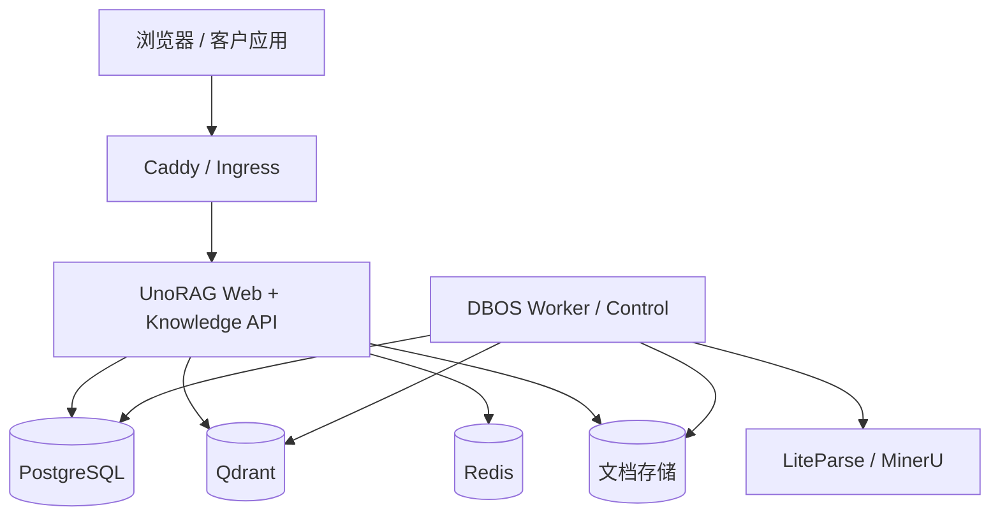

# UnoRAG 私有化部署

UnoRAG 提供两种客户部署入口：Docker Compose 是单机参考拓扑，Helm Chart 是客户托管
Kubernetes 的起点。两者使用相同的四个 Node 镜像和相同的产品数据模型。

## 运行拓扑



公网只暴露 Web。Worker、PostgreSQL、Qdrant、Redis、DBOS 管理端点和 ParserProvider
必须位于客户内网。PostgreSQL `app` schema 是唯一业务事实源，DBOS 使用独立 system database。

## Compose 安装

宿主机需要 Docker、Docker Compose v2、Python 3 和 OpenSSL。Python 只用于配置迁移及验收脚本，
四个产品镜像均为 Node 运行时。使用官方 `--manifest` 执行签名校验时，还需预装 **Cosign v3（`>= 3.0`）**
（GHCR 使用 OCI 1.1 referrer 新 bundle，Cosign v2 会报 `no signatures found`）。

### 本地体验一键启动

macOS、Linux 或 WSL 已安装并启动 Docker 时，可在仓库根目录运行：

```bash
./start.sh
```

首次运行会安全询问 `LLM_API_KEY`，生成 gitignored 的数据库、Session 和管理员密钥，使用默认
`8080` 端口构建并启动完整 Compose 环境。宿主机没有 Python 时，脚本通过临时 Docker helper 执行
配置初始化。可使用 `./start.sh --help` 查看端口、Ops Stack、manifest 和无浏览器模式。

该入口用于本地体验和开发，默认构建当前工作树，**不属于正式客户交付**。生产安装必须继续使用下面的
release manifest、平台预检和显式配置流程。模型凭据不会被内置；非交互环境必须通过
`LLM_API_KEY` 提供。

### 正式安装

当前发布物只认证 `linux/amd64`。生产安装前必须确认宿主机或 Kubernetes 节点提供该架构；
`linux/arm64` 和 multi-arch 尚不属于支持范围。Apple Silicon 本地验收可以只对四个产品服务显式设置
`platform: linux/amd64`；仓库提供的 `docker-compose.local-amd64.yml` 会覆盖所有使用四类 UnoRAG
产品镜像的运行、迁移和运维服务。模拟运行不代表生产容量结论，也不得让全局
`DOCKER_DEFAULT_PLATFORM` 连带改变 PostgreSQL、Qdrant 和 Redis 等基础设施镜像架构。
官方 manifest 使用 `UNORAG_IMAGE_PLATFORM` 声明产品镜像架构，安装与升级会在拉取镜像或进入维护
窗口前校验 Docker Engine。架构不匹配默认直接拒绝；仅本地验收可在已提供产品服务 platform overlay
后显式传入 `--allow-platform-emulation`。该参数不是生产部署选项。

```bash
cd deploy/compose
./scripts/init-config.sh
./scripts/prepare-runtime-db-secrets.sh --bundled-postgres
# prepare-runtime-db-secrets.sh 只生成三个最小权限 DB 密码（WEB/WORKER/DBOS）；
# 请在 ../config/runtime.secret 中补全 POSTGRES_PASSWORD、UNORAG_SESSION_SECRET（>= 32 字符）和 LLM_API_KEY。
# 可用以下命令生成两段 64 位随机值写入 ../config/runtime.secret：
#   openssl rand -hex 32
# 检查 ../config/runtime.env（HTTP_PORT、模型地址与名称）；高级调优按需修改
./scripts/install.sh --manifest /path/to/release-ghcr.env
# 仅 Apple Silicon 本地验收，并且 overlay 只设置 UnoRAG 产品服务：
UNORAG_COMPOSE_OVERLAY=./docker-compose.local-amd64.yml \
  ./scripts/install.sh --manifest /path/to/release-ghcr.env --allow-platform-emulation
```

配置按操作频率分层，脚本会以 `0600` 创建实际文件，并在升级时保留已有值：

| 文件 | 用途 | 通常是否修改 |
|---|---|---|
| `runtime.env` | 端口、域名、存储、模型与核心数据服务，共 15 项 | 是 |
| `runtime.advanced.env` | 镜像 pin、限流、MinerU、DBOS 并发、通知与 OTel | 仅调优或发布时 |
| `runtime.secret` | 数据库、Session、模型、COS 与通知凭据 | 是 |
| `bootstrap.env` | 首次管理员与组织初始化 | 首次安装时 |

旧版本把所有非敏感项放在 `runtime.env`。首次运行新版本的 `init-config.sh` 或
`upgrade.sh` 会自动把高级项移入 `runtime.advanced.env`，并保留自定义项。示例中省略的调优项使用内置默认值，仍可在该文件中显式覆盖。

新部署默认启用 Qdrant `lexical_v1` IDF + RRF 混合检索，词法检索无需额外的模型 API 调用。
在 `runtime.advanced.env` 设置 `TS_RETRIEVAL_HYBRID_ENABLED=false` 可在整个部署禁用混合检索；设置 `TS_RETRIEVAL_RERANK_ALLOWED=false` 可在整个部署硬禁用重排（覆盖工作区的 `reranking` 策略与自动/重试重排）。
工作区可通过 `hybrid_retrieval: "off"` 禁用混合检索，包括问答重试。选择 `inherit` 时，
`retrieval_enhancement: "off"` 同样禁用混合检索。自动模式在对比、精确编号等查询的首轮启用重排。
升级保留已有的显式关闭值。

正式安装必须使用发布 workflow 生成的 digest manifest。没有 `--manifest` 时安装脚本会构建当前
工作树镜像，该模式只用于本地开发，不属于可交付安装。manifest 会同时固定四个镜像和 DBOS
application version；缺少字段、使用 tag、`latest` 或不完整 digest 时安装会直接拒绝。
GHCR 与 ACR 可能采用不同的 Cosign 签名存储布局；安装脚本从 manifest 读取并验证该布局，不能把
一个 Registry 的验签参数套到另一个 Registry。GHCR 镜像使用 OCI 1.1 referrer 新 bundle，
安装机需安装 **Cosign v3（`>= 3.0`）**（Cosign v2 会报 `no signatures found`）；如宿主机暂不安装二进制，
可先用官方容器镜像 `ghcr.io/sigstore/cosign/cosign:v3.0.2` 独立核验 manifest 中的 4 个 digest。

需要集中指标、日志和 Trace 时，设置 `runtime.secret` 中的 `GRAFANA_ADMIN_PASSWORD` 后显式启用：

```bash
./scripts/install.sh --with-observability
```

该选项增加 Collector、Prometheus、Grafana、Loki、Tempo 和 Alertmanager，但不改变业务数据事实源。
Grafana 默认仅监听 `127.0.0.1:3300`，其它观测后端不发布宿主机端口；停止它们不会停止 UnoRAG。

已有独立 Langfuse 或 Langfuse Cloud 项目时，可再配置 `LANGFUSE_OTLP_ENDPOINT` 和 Collector-only
`LANGFUSE_OTLP_AUTHORIZATION`，使用 `./scripts/install.sh --with-langfuse`。该模式自动包含 Ops Stack，
并由 Collector 将脱敏后的同一 Trace 双写 Tempo/Langfuse；数据边界和排障见
[OPERATIONS.md](./OPERATIONS.md#可选-langfuse)。

必要 Secret 包括：

- `POSTGRES_PASSWORD`
- 独立的 `UNORAG_WEB_DB_PASSWORD`、`UNORAG_WORKER_DB_PASSWORD`、`UNORAG_DBOS_DB_PASSWORD`
- 至少 32 字符的 `UNORAG_SESSION_SECRET`
- `LLM_API_KEY`
- 仅用于首次初始化的 `UNORAG_ADMIN_PASSWORD`；`init-config.sh` 会为新实例随机生成

新实例默认管理员为 `admin@unorag.local`，可以在安装前通过 `bootstrap.env` 修改。每个实例的初始密码
独立生成并保存在同一文件中，不存在跨部署共用的产品默认密码。首次登录必须修改密码；服务端重置密码后
也会重新进入该流程。重复安装不会覆盖已有凭据。需要重置时，先更新 `bootstrap.env` 中的密码，再运行
`deploy/compose/scripts/rotate-admin-password.sh`。

Redis 是 Web 的必需依赖，用于可撤销浏览器会话、登录/Public API 分布式限流和 Ask 短期记忆。它必须
保持内网可达且不应发布宿主机端口；Redis 故障时安全相关入口 fail closed，已有业务数据仍以 PostgreSQL、
对象存储和 Qdrant 为准。限流默认值位于 `runtime.advanced.env`，多 Web 副本共享同一 Redis 后无需额外的进程内
计数器。

新密码长度为 7–256 个字符，并且必须同时包含大写和小写字母。该规则适用于首次改密、邀请用户设置密码
和管理员主动重置；升级不会强制改写已有用户密码。

### 可选账号邮件

在 `runtime.advanced.env` 设置 `EMAIL_PROVIDER=resend`，并在 `runtime.env` 设置规范访问地址
`UNORAG_BASE_URL=https://unorag.example.com`。`runtime.advanced.env` 中的 `APP_BASE_URL` 优先用于账号邮件。
在 `runtime.secret` 设置已验证发件人 `EMAIL_FROM`
及 `RESEND_API_KEY`，然后重新创建 Web 与 control 容器。服务端使用 Resend HTTPS API，
不需要额外 SMTP 服务，也不读取 `SMTP_*`。本地开发只允许 loopback 地址使用 HTTP。

邀请、邮箱链接登录、忘记密码共用这组传输配置，不使用工作区告警收件人列表。
私有化部署仍为邀请制：没有公开注册入口；邮箱链接不会为未知地址创建账号或授予权限。
邀请中的已有账号须验证原密码，新账号才设置密码。邮件未配置时仍可密码登录和复制邀请链接。
账号邮件的有效期、安全限制及失败排查见 [运维指南](./OPERATIONS.md#账号邮件)。

外部 PostgreSQL 应由客户创建等价最小权限角色，并分别配置 `WEB_DATABASE_URL`、
`WORKER_DATABASE_URL`、`DBOS_SYSTEM_DATABASE_URL` 与 `MIGRATOR_DATABASE_URL`。
Web 和 Worker 运行身份不得拥有 DDL 权限。

模型端点、本地模型服务与按能力拆分配置见 [模型供应商与本地模型服务](#模型供应商与本地模型服务)。
自托管 MinerU 地址只使用 `runtime.advanced.env` 中的 `MINERU_SELF_HOSTED_URL`；升级初始化会将历史
`MINERU_URL` 一次性迁移并删除旧键。

安装程序依次启动基础设施、执行 Drizzle 迁移、配置数据库角色、初始化首个组织、Workspace
和管理员、启动 DBOS、对账 ACL 投影，最后启动 Web 与 Caddy。

如需部署覆盖文件，必须在每次操作中显式选择：

```bash
export UNORAG_COMPOSE_OVERLAY=./docker-compose.customer.yml
./scripts/install.sh
```

同一变量也应供后续升级、备份、恢复和 `mk_compose` 命令使用，避免意外切换拓扑。

### 公网 HTTPS

域名 A 记录指向部署主机并完成公共解析后，在 `runtime.env` 中配置：

```dotenv
UNORAG_DOMAIN=unorag.example.com
UNORAG_BASE_URL=https://unorag.example.com
```

使用仓库内置公网覆盖层启动：

```bash
cd deploy/compose
source scripts/compose-env.sh
UNORAG_COMPOSE_OVERLAY=./docker-compose.public.yml mk_compose up -d
```

Caddy 会自动申请和续期证书，并将 HTTP 重定向到 HTTPS。该覆盖层只发布 80/443，证书与
Caddy 状态保存在命名卷中；Web 之外的数据服务和 Worker 仍不发布宿主机端口。UnoRAG 的公开
参考实例位于 [unorag.unobyte.dev](https://unorag.unobyte.dev)。

## 模型供应商与本地模型服务

UnoRAG 通过标准 OpenAI-compatible HTTP 接口调用 Chat、Embedding、Judge、Rerank 与可选 VLM，
**不绑定特定模型厂商**。部署时修改配置文件即可切换云端供应商，或接入内网 / 本机的 Ollama、vLLM、
SGLang、Xinference、One-API、LiteLLM 等模型服务。

### 1. 主模型入口与凭据解析规则

Compose 使用 `runtime.env` 中的 `LLM_BASE_URL`、`CHAT_MODEL`、`EMBEDDING_MODEL`、`EMBEDDING_DIM`
和 `runtime.secret` 中的 `LLM_API_KEY`；Helm 使用 `config.llmBaseUrl` 和 Secret 的 `LLM_API_KEY`。
应用按 `LLM_*`、`OPENAI_*`、`DASHSCOPE_*` 的顺序，选择首个含非空地址或密钥的命名空间，**不跨组拼接地址与密钥**。
所选组必须提供非空 API Key；未提供地址时，使用默认 `https://dashscope.aliyuncs.com/compatible-mode/v1`，
因此只配置 Key 是使用默认 DashScope 的有效配置。自定义网关必须显式配置同组地址与匹配密钥；只配置地址而缺少密钥会报错，
不会从低优先级组补齐。Compose 保留各组原值，Helm 统一使用 `LLM_*`。

### 2. 切换云端 OpenAI-compatible 供应商

编辑 `deploy/config/runtime.env` 与 `deploy/config/runtime.secret`：

```dotenv
# 示例：OpenAI 官方（或任意 OpenAI-compatible 聚合网关，如 One-API / LiteLLM / 硅基流动）
LLM_BASE_URL=https://api.openai.com/v1
CHAT_MODEL=gpt-4o-mini
EMBEDDING_MODEL=text-embedding-3-small
EMBEDDING_DIM=1536
```

```dotenv
# deploy/config/runtime.secret
LLM_API_KEY=sk-your-provider-key
```

> 若对话供应商（例如 DeepSeek）不提供 Embedding 接口，请使用下文的「按能力拆分端点」，将 `EMBEDDING_BASE_URL`
> 指向独立的云端或本地 Embedding 服务。

### 3. 接入本机 / 内网本地模型服务（Ollama / vLLM / SGLang / Xinference）

接入宿主机或内网自托管模型服务需注意三点：

1. **宿主机监听地址**：宿主机模型服务必须监听 `0.0.0.0`（或 Docker 网桥 IP），不能只绑定 `127.0.0.1`。
   例如 Ollama 启动前设置 `OLLAMA_HOST=0.0.0.0:11434`，vLLM 启动加 `--host 0.0.0.0 --port 8000`。
2. **容器访问宿主机地址**：Compose 已为 `web`、`dbos-worker` 与 `dbos-control` 配置
   `extra_hosts: ["host.docker.internal:host-gateway"]`（Linux / macOS / Windows 通用），容器内可直接填写
   `http://host.docker.internal:<port>/v1`。若模型服务也在同一 Docker 网络内，可直接填容器服务名（如 `http://vllm:8000/v1`）；
   若在局域网其他机器，填内网 IP 或域名即可。
3. **无鉴权本地服务的 API Key**：UnoRAG 会严格校验所选命名空间存在非空 `LLM_API_KEY`；对不校验 Token 的本地服务，
   在 `runtime.secret` 中填写任意非空占位符即可（例如 `LLM_API_KEY=local-no-auth`）。

#### 示例 A：单机全本地 Ollama

先在宿主机拉取模型并确保监听 `0.0.0.0:11434`（如 `ollama pull qwen2.5:14b && ollama pull bge-m3`）：

```dotenv
# deploy/config/runtime.env
LLM_BASE_URL=http://host.docker.internal:11434/v1
CHAT_MODEL=qwen2.5:14b
EMBEDDING_MODEL=bge-m3
EMBEDDING_DIM=1024
```

```dotenv
# deploy/config/runtime.secret
LLM_API_KEY=local-no-auth
```

#### 示例 B：vLLM 对话 + 独立本地 Embedding（拆分端点）

```dotenv
# deploy/config/runtime.env
LLM_BASE_URL=http://host.docker.internal:8000/v1
CHAT_MODEL=Qwen/Qwen2.5-32B-Instruct
EMBEDDING_MODEL=bge-m3
EMBEDDING_DIM=1024
```

```dotenv
# deploy/config/runtime.advanced.env
EMBEDDING_BASE_URL=http://host.docker.internal:11434/v1
```

```dotenv
# deploy/config/runtime.secret
LLM_API_KEY=local-no-auth
# 独立端点地址与 LLM_BASE_URL 不同，必须提供对应的 *_API_KEY（无鉴权服务也需非空占位符）
EMBEDDING_API_KEY=local-no-auth
```

### 4. 按能力拆分端点与凭据隔离

Embedding、Judge、Rerank 与 VLM 均可在 `runtime.advanced.env` 中配置独立 `*_BASE_URL` / `*_MODEL`，
并在 `runtime.secret` 中配置对应 `*_API_KEY`：

- **同端点继承，异端点隔离（Fail-closed）**：仅当子端点与主 `LLM_BASE_URL` 完全一致时，才自动继承 `LLM_API_KEY`
  （另允许已知 DashScope Chat/Embedding 与 Rerank 两条官方 API 路径共享同厂凭据）。只要地址与主端点不同，
  就必须在 `runtime.secret` 提供对应的专用密钥（即使是无鉴权本地服务，也需填 `local-no-auth` 等占位值），防止主密钥意外外发。
- **Web 与 Worker 一致性**：Web 查询与 Worker 入库必须使用同一组 Embedding 配置；Compose 会同时注入两者。
- **Control 同步与 VLM 边界**：Compose 会向 `dbos-control` 同步 Web 的 Judge/VLM 绑定与开关，Control 只做配置健康检查，不调用模型。
  VLM 目前仅 Compose/本地配置已接入；Helm 尚未接入 VLM 配置与凭据注入，仅向 Helm Secret 添加 `VLM_API_KEY` 不会启用 VLM。

### 5. 本地网关兼容性开关与 Rerank

部分本地模型或轻量网关不完全支持 OpenAI 最新参数，可在 `deploy/config/runtime.advanced.env` 按需调整：

| 变量 | 默认值 | 何时调整 |
|---|---|---|
| `AI_SUPPORTS_STRUCTURED_OUTPUTS` | `true` | 对话网关或小参数本地模型不支持 OpenAI `json_schema` 结构化输出时设为 `false` |
| `JUDGE_SUPPORTS_STRUCTURED_OUTPUTS` | `true` | Judge 模型不支持 `json_schema` 时设为 `false` |
| `AI_INCLUDE_USAGE` | `true` | 网关拒绝流式 `stream_options.include_usage` 参数时设为 `false`（用量保持未知，不伪造 0） |
| `TS_RETRIEVAL_RERANK_ALLOWED` | `true` | 需要在整个部署硬禁用重排（覆盖工作区策略）时设为 `false` |

关于 Rerank：

- 切换到非 DashScope 主网关且未配置 `RERANK_BASE_URL` 时，UnoRAG 不会创建默认外部 Reranker；运行中心会显示合法的 `disabled`，
  **不会触发异常告警**。但若配置了非法地址或异端点缺少 `RERANK_API_KEY`，即使 `TS_RETRIEVAL_RERANK_ENABLED=false` 也会显式报 `degraded`。
- 如需接入自托管 Rerank 服务（如 Xinference、vLLM 或自定义代理），服务端需提供 `POST <RERANK_BASE_URL>/reranks` 接口并返回
  `{ "results": [{ "index": 0, "relevance_score": 0.92 }] }`，并在 `runtime.advanced.env` 设置 `RERANK_BASE_URL`、`RERANK_MODEL`，
  在 `runtime.secret` 设置 `RERANK_API_KEY`（无鉴权同样填占位符）。

### 6. Embedding 维度、Qdrant 集合与纯本地零云端模式

更换 Embedding 模型时，必须同步更新 `runtime.env` 中的 `EMBEDDING_DIM`：

| 常见 Embedding 模型 | `EMBEDDING_DIM` |
|---|---|
| `text-embedding-v3` / `BAAI/bge-m3` / `bge-m3` | `1024` |
| `nomic-embed-text` / `BAAI/bge-base-zh-v1.5` | `768` |
| `text-embedding-3-small` | `1536` |
| `text-embedding-3-large` | `3072` |
| `Qwen3-Embedding-8B` | `4096` |

- **空实例**：在入库首份文档前切换维度，直接改 `EMBEDDING_DIM` 并重建容器即可。
- **已有生效文档的实例**：不能在同一 Qdrant 集合内混用不同维度，否则 `/api/rag/health/ready` 会报告 `embedding_dimension_mismatch`。
  请在 `runtime.advanced.env` 将 `QDRANT_COLLECTION` 改为新集合名并重新索引文档。
- **纯本地零外网模式**：将模型端点全部指向本机/内网服务，同时保持 `MINERU_PROVIDER=self_hosted`、`EXTERNAL_PARSER_ALLOWED=false`。
  `MINERU_SELF_HOSTED_URL` 留空时默认使用 Worker 内置 LiteParse + 预装 Tesseract OCR；如需高精度 PDF 解析，可指向内网或宿主机自托管
  MinerU（如 `MINERU_SELF_HOSTED_URL=http://host.docker.internal:6006`）。

### 7. 应用配置变更并验证

修改上述配置后，必须同时重建 `web`、`dbos-worker` 与 `dbos-control`，确保入库、检索、问答与运行中心检查读取同一套绑定：

```bash
cd deploy/compose
source scripts/compose-env.sh
mk_compose up -d --force-recreate web dbos-worker dbos-control
# 端口按 runtime.env 中的 HTTP_PORT 替换（默认 80，本地 ./start.sh 默认 8080）
curl -fsS http://localhost:8080/api/rag/health/ready | jq .
```

确认返回 HTTP 200 且 `ask_ready: true`、`degraded: false` 即可开始入库与问答。

## ParserProvider

LiteParse 是 Worker 内的本地快速路径。

Worker 镜像预装 Tesseract 简体中文（`chi_sim`）与英文（`eng`）语言数据，OCR 不在运行时下载模型。
Compose 默认使用 `chi_sim`；原 `ch` / `zh` 配置会规范为 `chi_sim`，`en` 规范为 `eng`。
其它单语言码需要由管理员预装对应 `.traineddata`，通过 Worker 的 `TESSDATA_PREFIX` 指向只读目录；
缺失数据会显式失败，不会隐式联网。源码开发启用 OCR 时也须设置该路径。
该本地能力不等于复杂表格结构或任意扫描件的质量保证，仍须用目标文件验收。

自托管 MinerU 示例：

```dotenv
MINERU_PROVIDER=self_hosted
MINERU_SELF_HOSTED_URL=http://mineru:6006
MINERU_TRANSPORT=sync
```

MinerU 地址应位于客户批准的信任边界内。选择 302.AI 会把文档上传到客户网络之外，必须
同时开启外部处理开关，且 API Key 只能进入 Worker Secret：

```dotenv
MINERU_PROVIDER=302ai
MINERU_302_BASE_URL=https://api.302.ai
EXTERNAL_PARSER_ALLOWED=true
MINERU_API_KEY=...
```

`local_only` 文库策略始终禁止云端解析。外部处理开关关闭时，路由器不得选择 302.AI。

部署管理员可通过 `PARSER_POLL_INTERVAL_MS`、`PARSER_MAX_WAIT_MS` 和逗号分隔的
`PARSER_RETRY_BACKOFF_MS` 调整解析任务轮询、总等待时间与瞬时故障退避。submit 重试复用同一
idempotency key，poll/fetch 重试复用同一远端 task；401/403 等永久错误不重试，429 优先服从
`Retry-After`。这些参数是部署能力，不进入 Workspace 或文库设置。

## 健康检查

```bash
curl -fsS http://localhost/api/rag/health/live | jq .
curl -fsS http://localhost/api/rag/health/ready | jq .
curl -fsS http://localhost/api/rag/health | jq .
source deploy/compose/scripts/compose-env.sh
mk_compose ps
mk_compose --profile ops run --rm inspect-lifecycle
```

| 组件 | 预期 |
|---|---|
| Web liveness | `/api/rag/health/live` 返回 200；只说明进程可响应，不探测下游依赖 |
| Web readiness | `/api/rag/health/ready` 检查 PostgreSQL、模型配置绑定及 Qdrant 的 Dense/维度/距离、Sparse IDF 和必要 payload 索引；失败返回 503 |
| Web 状态详情 | `/api/rag/health` 保持兼容，返回 `ask_ready`、`degraded` 与 `reasons`，供 UI 和诊断读取 |
| DBOS Worker | 私有 `:3001/dbos-healthz` 正常 |
| DBOS Control | ready marker 持续更新 |
| PostgreSQL | `pg_isready` 正常 |
| Qdrant | 私有 `:6333` ready |
| Redis | `redis-cli ping` 正常 |

当 `/api/rag/health` 或运行中心报告 `embedding_dimension_mismatch` 时，请在 Web 和 Worker 使用相同配置。
若所用模型支持现有集合的维度，将 `EMBEDDING_DIM` 调整为提示中的集合维度。
若要使用新维度，将 `QDRANT_COLLECTION` 指向新集合并重新索引。
只有 PG 明确没有生效文档时，尚未创建或为空的集合才允许初始化；PG 已有生效文档时，集合不存在或完全为空会使问答不就绪。
健康探针只读，不创建集合或补写索引，也不逐文档证明全部 Point 完整；初始化由正常入库/检索的集合管理器完成。

## 镜像与升级

发布物包含 `web`、`migrator`、`ops` 和 `worker` 四个镜像。发布 workflow 会把同一次构建
推送到镜像仓库，并产出引用四个镜像 digest 的 manifest。生产升级只接受这类已归档的
digest manifest，禁止直接使用浮动 `latest`。`upgrade.sh` 也接受带版本 tag 的 manifest，
但该入口只用于本地 RC 验收和无法访问 registry 时的 break-glass 操作，不能替代生产发布物。
当前镜像架构支持范围以本页 Compose 安装章节为准；上线验收必须在客户实际节点架构上重跑。

```bash
cd deploy/compose
./scripts/backup.sh ./backups/pre-upgrade
./scripts/upgrade.sh --manifest /path/to/release-registry.env
# 已部署 Ops Stack 时保留 OTLP 连接和看板：
./scripts/upgrade.sh --manifest /path/to/release-registry.env --with-observability
```

升级前应确认备份可读、生命周期巡检无 dead/stuck/pending ACL，并归档当前配置摘要。正式发布
manifest 会从 Git commit 生成 `unorag-<sha>` DBOS application version；不得在不同提交间复用
`dev-local` 或历史版本。升级也会先校验 manifest 的产品镜像架构；本地模拟升级使用与安装相同的
overlay 和显式开关。脚本随后：

1. 保存当前四镜像引用与 DBOS application version；
2. 拉取候选镜像；若 DBOS version 改变，停止 Web/edge 接收新写入，并等待业务任务表与旧版本
   DBOS workflow 同时归零；
3. 停止旧 control/worker，执行只向前数据库迁移与运行时角色验证；
4. 启动新版本 DBOS worker/control，执行 ACL 对账与生命周期巡检；
5. 替换 Web，检查结构化健康状态并运行真实上传、Ask、替换、删除与隔离冒烟。

排空默认最多等待 1800 秒（可通过 `DBOS_UPGRADE_DRAIN_TIMEOUT_SECONDS` 调整）；超时或无法排空时拒绝版本切换，不强制中断在途 workflow。上一个镜像集合保存在 `.upgrade-state/previous-images.env`，失败时自动或手动作为 manifest 传给 `upgrade.sh` 回滚应用镜像。数据库仅向前迁移，破坏性 schema 变更须遵循 expand / migrate / contract。

Compose 为单机参考拓扑（DBOS 版本变更存在短维护窗口），不承诺零停机。

## 备份与恢复

```bash
./scripts/backup.sh ./backups/$(date +%Y%m%dT%H%M%S)
CONFIRM=YES ./scripts/restore.sh ./backups/<backup-id>
```

备份覆盖 PostgreSQL、DBOS 与 Qdrant（`local` 同时归档文档卷；`cos` 只记录桶边界，原文依赖 COS 版本控制/复制；Redis 会话可重建）。恢复顺序、失败判定与演练要求见 [运维指南 · 备份与灾难恢复](./OPERATIONS.md#备份与灾难恢复)。

## Kubernetes

Chart 位于 [`deploy/helm/unorag`](../deploy/helm/unorag)，默认使用客户托管的 PostgreSQL、
Qdrant 和 Redis，并支持共享 PVC 或腾讯云 COS 文档存储。Helm starter 尚不承诺完整 HPA、PDB、
NetworkPolicy 或通用 S3；这些能力应按
客户基础设施和 [STATUS.md](./STATUS.md) 的当前边界评估。

### 腾讯云 COS

COS 必须保持私有。Web 与 DBOS Worker 使用同一 Bucket、Region 和受限 CAM 凭证；原文下载仍由
UnoRAG 校验 Session、Organization、Workspace、文档 ACL 和 active version 后代理返回。自定义域名
仅用于受控访问标识，不应通过公共读权限绕过应用鉴权。

桶在香港、应用在本地或其它地域都可以：UnoRAG 通过 HTTPS 调用 COS API，不要求把 Web/Worker
部署在同一地域。生产切存储前，先在 Compose 开发环境用同一套驱动和密钥跑通冒烟与产品链路。

#### 1. 主账号创建私有桶

用主账号（或有建桶权限的管理员）在 [对象存储](https://console.cloud.tencent.com/cos) 创建桶：

- 访问权限选 **私有读写**。不要公有读、不要匿名 `GetObject`。
- 记下 `桶名-APPID`（例如 `unobyte-1311896385`）、地域（例如 `ap-hongkong`）和 APPID。
- 不要用后面那个 API 子用户去建桶；它不应拥有 `PutBucket` / `DeleteBucket`。

#### 2. 专用 CAM 子用户和 API 密钥

在 [访问管理 → 用户](https://console.cloud.tencent.com/cam/user) 新建子用户：

- 勾选 **编程访问**。控制台访问可选，不是 UnoRAG 运行时需要的。
- 在该子用户页创建 API 密钥。SecretKey 只在创建时显示一次。
- `runtime.secret` 必须使用这个子用户、且状态为 **已启用** 的密钥。禁用密钥会表现为 PUT `AccessDenied`。
- 不要使用主账号永久密钥。

#### 3. CAM 用户策略（主配置）

在 [访问管理 → 策略](https://console.cloud.tencent.com/cam/policy) 新建自定义策略，并 **授权给上一步那个子用户**。
不要把 COS 控制台的「关联 CAM 策略」或「所有用户 / 可匿名访问」当作主路径。

CAM **用户策略** 与 COS **桶 Policy** 语法不同。用户策略必须用 `cos:PutObject` 这种 action，
资源用 `qcs::cos:<region>:uid/<APPID>:<bucket-appid>/<prefix>/*`。以下写法能保存但运行时 403：

- `name/cos:PutObject`（桶策略语法）
- `qcs:cos:...`（`qcs` 后少一个冒号，六段式会错位）
- `prefix//<bucket>/...`（CAM 校验能过，对象 API 不按这个路径求值）

UnoRAG 上传会带 `ACL: private`，因此还要 `cos:PutObjectACL`。产品对象键以 `org/` 开头，
冒烟脚本使用 `_unorag-smoke/`。将 `<APPID>`、`<bucket-appid>`、`<region>` 换成实际值：

```json
{
  "version": "2.0",
  "statement": [
    {
      "effect": "allow",
      "action": [
        "cos:PutObject",
        "cos:PutObjectACL",
        "cos:HeadObject",
        "cos:GetObject",
        "cos:DeleteObject"
      ],
      "resource": [
        "qcs::cos:ap-hongkong:uid/1311896385:unobyte-1311896385/org/*",
        "qcs::cos:ap-hongkong:uid/1311896385:unobyte-1311896385/_unorag-smoke/*"
      ]
    }
  ]
}
```

不要长期挂 `QcloudCOSDataFullControl`。仅在自定义策略 403 时临时挂上对照：FullControl 能通、自定义不能，
说明 action/resource 语法仍不对，而不是桶或密钥坏了。对照结束后立刻摘掉。

可选：在桶的「用户权限」里把该子用户加成 **数据读取 + 数据写入**。公共权限保持私有读写。
不要在桶 Policy 里授权所有用户。

#### 4. 写入部署配置

`deploy/config/runtime.env`（gitignored）：

```dotenv
DOCUMENT_STORAGE_DRIVER=cos
COS_BUCKET=unobyte-1311896385
COS_REGION=ap-hongkong
COS_PUBLIC_BASE_URL=
```

`deploy/config/runtime.secret`（gitignored）：

```dotenv
COS_SECRET_ID=
COS_SECRET_KEY=
COS_SECURITY_TOKEN=
```

从仓库模板复制：`runtime.env.example` → `runtime.env`、
`runtime.advanced.env.example` → `runtime.advanced.env`、
`runtime.secret.example` → `runtime.secret`。
Compose 安装脚本在 `DOCUMENT_STORAGE_DRIVER=cos` 时会拒绝缺少桶、地域或密钥的配置。

#### 5. 对象存储冒烟

不依赖数据库。脚本只读写随机 `_unorag-smoke/` 键并在结束时删除：

```bash
set -a
source deploy/config/runtime.env
source deploy/config/runtime.secret
set +a
pnpm smoke:cos
```

PowerShell 没有 `set -a`；把同一组变量导入当前会话后再运行 `pnpm smoke:cos`。

#### 6. 产品链路验收

冒烟通过后，用完整 Compose（Web + DBOS Worker，不要只跑 `pnpm dev`）再验收：

1. 登录 Workspace，向文库上传一个小的 Markdown 或 TXT。
2. 等待 DBOS ingest 任务 `completed`。
3. 从产品 UI 下载原文（必须走 UnoRAG 鉴权代理，不能用 COS 匿名 URL）。
4. Ask 一句能命中该文档的问题，确认引用。
5. 删除文档，确认任务完成；COS 中对应 `org/...` 对象消失。

| 现象 | 常见原因 |
|---|---|
| PUT `AccessDenied` | 密钥已禁用、密钥不属于被授权子用户、用户策略用了 `name/cos:` 或 `prefix//`、漏了 `PutObjectACL` |
| `NoSuchBucket` | `COS_BUCKET` 未带 APPID，或 `COS_REGION` 写错 |
| 冒烟过、产品上传卡住 | 只起了 Next.js，没有 DBOS Worker，或 Worker 未注入同一套 COS 变量 |
| 匿名 URL 能下载 | 桶不是私有，或自定义域名开了公有读 |

Helm 不安装官方单机 Ops Stack；Kubernetes 客户应复用现有 Collector/APM，设置
`observability.otel.enabled=true` 与 `observability.otel.endpoint`。启用但未提供 endpoint 时 Chart
会拒绝渲染。可选认证头通过 Runtime Secret 的 `OTEL_EXPORTER_OTLP_HEADERS` 注入。

Helm 配置详见 [`deploy/helm/README.md`](../deploy/helm/README.md)，Compose 脚本位于 `deploy/compose/scripts/`。上线判定以 [RELEASE.md](./RELEASE.md) 为准。
