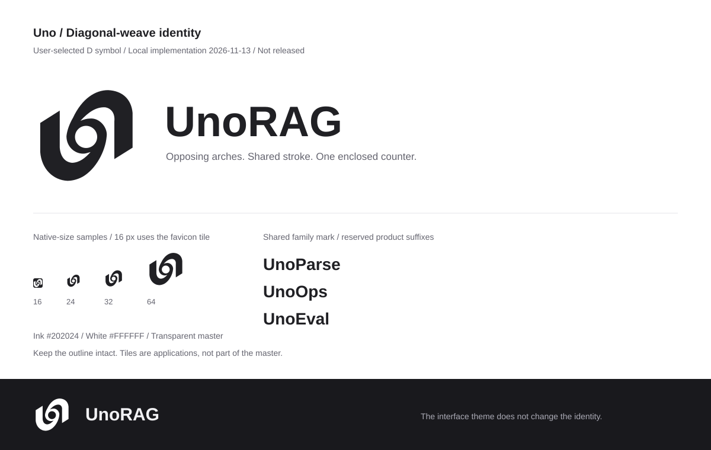

# Uno 品牌系统

> 状态：**2026-11-13 已选定 D「对向交错」方向；SVG 与应用资产在本地落地，待最终视觉验收，尚未发布。**
> 名称与素材的对外使用规则见
> [商标使用政策](../../TRADEMARKS.md)；本文不是不可变的品牌承诺。

Uno 是 Unobyte.dev 及其产品的母品牌。已选定的紧凑符号以两条对向弧线组成近方形剪影：
下方的 U 形与上方的 n 形共用斜向笔画，中央闭合圆孔呼应 o；两端保留同一方向的斜切。
这是字母关系的抽象，不要求小图中逐字读出 `uno`，完整名称由邻近字标提供。

选定稿来自本轮 AI 辅助概念探索，随后重绘为原生 SVG；正式资产不嵌入概念 PNG。
早期横向 UNO、波形字标和 E「闭环负形」不再作为当前运行时标志，也不同时发布为第二套主符号。

## 品牌架构

| 层级 | 命名 | 用法 |
|---|---|---|
| 母品牌 | Unobyte | 官网、团队与组织身份 |
| 产品 | UnoRAG | 企业知识产品 |
| 产品 | UnoParse | 文档解析能力（预留） |
| 产品 | UnoOps | 运维与可观测能力（预留） |
| 产品 | UnoEval | 评测能力（预留） |

所有产品使用同一个 Uno 图形，不为后缀重新设计图标。字标保持 `Uno` 不变，产品后缀与字标使用同一前景色。
预留产品名不是已交付能力或独立软件清单。

## 视觉语言

本节颜色用于标志、字标和品牌资产，不是工作台全局配色。产品界面遵循
[产品设计规范](../DESIGN.md) 的中性底色、语义状态和交互强调。Logo 没有固定的交互主色，
不随 Vercel、Claude、Violet Bloom 等界面主题或圆角预设改变图形。

| Token | 色值 | 用途 |
|---|---|---|
| Ink | `#202024` | 浅色背景中的标志；图标底板 |
| White | `#FFFFFF` | 深色背景中的反白标志 |
| Interface foreground | 界面语义 Token | 字标，随浅深色调整 |

- 对向弧线、共享斜笔画与中央圆孔是固定识别特征，不另加节点、彩点或与 AI 相关的装饰。
- 字标优先使用 IBM Plex Sans；技术标签和版本信息使用 IBM Plex Mono。
- 品牌图形不使用负字距、渐变、外发光、阴影、星芒或额外网络节点；界面中真正浮层的轻微中性阴影
  按产品设计规范处理，不等于给 Logo 增加效果。

## 尺寸与留白

- 普通导航使用 `24–32px` 的透明底符号并显示完整名称；`16px` 主要用于 favicon 等受限位置。
- `16px` 不代表完整字母可读性已保证。验收须使用真实像素栅格，检查中央圆孔与两处开口；
  不把画板中「高 16px」的横向字标当作 `16×16` 图标测试。
- 独立展示时建议留出可见轮廓宽度 `1/4` 的外部空间；紧凑导航保留 SVG 内部安全边距及字标间距。
- **方形底板不是符号本体。** 工作台、首页和登录页使用透明底；favicon 使用反白符号与中性圆角底板，
  Apple touch icon 使用不透明中性底色，由设备处理外部裁切。
- 所有尺寸与反白版本使用同一母版，不单独拉伸、加描边或手工修 PNG。若真实小尺寸仍有辨识问题，
  应在本规范中说明光学适配差异后再增加受控变体，不能无记录替换为另一种造型。

## 文件与组件

- `public/brand/uno-mark.svg` 是唯一矢量主源。
- `uno-mark-white.svg`、黑白 PNG、`uno-favicon.svg`、`favicon-16x16.png`、`favicon-32x32.png`
  和 Apple touch icon 都从该主源生成；不维护第二份路径。
- `UnoLogo` 接受产品后缀；`UnoRAGLogo` 是当前产品的兼容封装。
- `UnoMark` 以原始 SVG 显示，随当前浅深主题使用正形或反白，不通过图片优化服务重采样 SVG。
- 在仓库根执行 `node scripts/generate-brand-assets.mjs`，从主源生成 PNG、favicon、Apple icon 和规范板；
  需要已经安装仓库的 Node.js 22 依赖。不可手工改 PNG 后把它当作新的主源。
- `node scripts/check-asset-provenance.mjs` 校验资产清单；图形或截图更新后必须同步 SHA-256。

## 权属提醒

该图形为项目内 AI 辅助概念与原生矢量重绘，未嵌入第三方 Logo 路径；UnoCSS 仅作为抽象方法的讨论参考，
没有采用其三块几何图形或排布。工程来源记录不等于独占权或商标可注册：公开发布前仍应对
`Unobyte`、`Uno` 和具体产品名在目标国家、地区及软件相关类别完成正式检索与法律确认。
商标政策已经明确开源许可之外的当前使用边界，但不替代该检索与法律确认。
